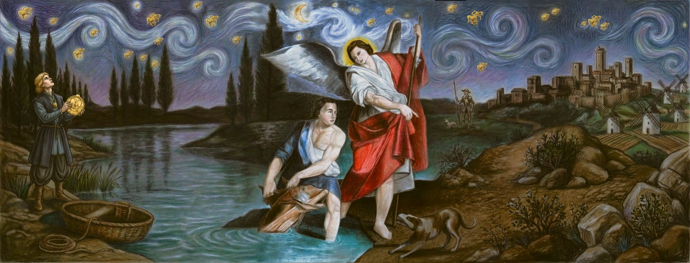
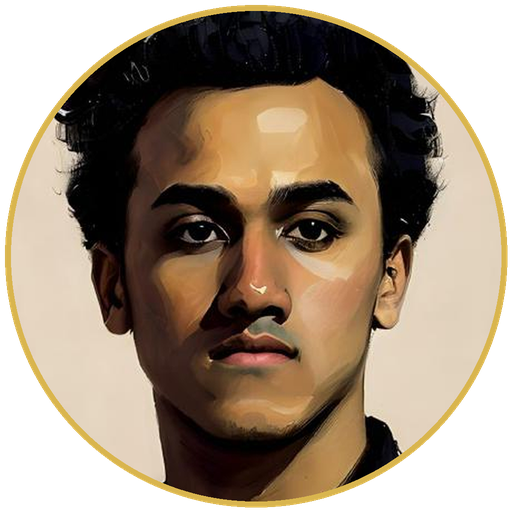

<!--
  Visual palette: indigo 0E1222 · gold D9B54E · teal 86CAD6 · text E6EDF3.
  Derived from assets/banner.jpg and used throughout the local artwork and badges.
-->

  

 

  

<h1 align="center">Philopateer Reda</h1>

  
  

  Electronics &amp; Telecommunication Engineering student · Python 
  <a href="https://www.linkedin.com/in/philopateer-reda-054881202/">LinkedIn</a>
  &nbsp;·&nbsp;
  <a href="mailto:filopateerredakamel2004@gmail.com">Email</a>

  

<h2 align="center">About</h2>

I build machine-learning systems and the evaluation around them. My recent work covers credit-default prediction, churn modeling, and applied NLP, with an emphasis on leakage control, calibration, and reproducible experiments. I am now going deeper into neural networks and deep learning through hands-on PyTorch work.

<h2 align="center">Selected ML Work</h2>

Recent GCI 2026 projects in tabular modeling, validation, and decision-focused evaluation.

<table>
  <thead>
    <tr>
      <th align="left" colspan="2">01 &nbsp;·&nbsp; <a href="https://github.com/philopateerreda/GCI-ML-Competition">GCI-ML-Competition</a> &nbsp;Credit-Default Prediction</th>
    </tr>
  </thead>
  <tbody>
    <tr>
      <td width="30%" valign="top">
          
        <b>Stack</b> 
        <code>Python</code> <code>PyTorch</code> <code>scikit-learn</code> 
        <code>LightGBM</code> <code>XGBoost</code> <code>CatBoost</code>
      </td>
      <td valign="top">
        <em>A leakage-safe pipeline for predicting loan default, built around trustworthy out-of-fold evaluation.</em>
        <ul>
          <li><b>Leakage control:</b> fold-local KNN target statistics and target encoding with self-exclusion, fingerprinted caches, and a label-permutation canary.</li>
          <li><b>Model selection:</b> nested-CV blending with a corrected standard-error gate; a tabular MLP sits alongside gradient-boosted trees.</li>
          <li><b>Experiment record:</b> failed tracks and leakage post-mortems remain documented instead of being hidden.</li>
        </ul>
        <b>Best public ROC-AUC: 0.76794.</b> 
        Local cross-validation drives selection because the public leaderboard differences are smaller than their noise.  
        <a href="https://github.com/philopateerreda/GCI-ML-Competition"><b>View repository →</b></a>
      </td>
    </tr>
  </tbody>
</table>

<table>
  <thead>
    <tr>
      <th align="left" colspan="2">02 &nbsp;·&nbsp; <a href="https://github.com/philopateerreda/GCI-Final-Assignment">GCI-Final-Assignment</a> &nbsp;Churn Prediction &amp; Retention Targeting</th>
    </tr>
  </thead>
  <tbody>
    <tr>
      <td width="30%" valign="top">
          
        <b>Stack</b> 
        <code>Python</code> <code>LightGBM</code> <code>scikit-learn</code> 
        <code>pandas</code> <code>Jupyter</code> <code>Matplotlib</code>
      </td>
      <td valign="top">
        <em>A calibrated churn-risk model paired with a value-aware retention policy and an explicit audit trail.</em>
        <ul>
          <li><b>Model:</b> sigmoid-calibrated LightGBM with frozen train, validation, calibration, and test partitions.</li>
          <li><b>Evaluation:</b> test ROC-AUC <b>0.6978</b>, with a bootstrap interval of <b>[0.6899, 0.7055]</b>.</li>
          <li><b>Targeting:</b> at equal contact-list size, value-aware ranking captured <b>20.83%</b> of churned recurring value versus <b>14.62%</b> for risk-only ranking.</li>
          <li><b>Limits:</b> measured ranking performance is clearly separated from retrospective, non-causal policy estimates.</li>
        </ul>
        <a href="https://github.com/philopateerreda/GCI-Final-Assignment"><b>View repository →</b></a>
      </td>
    </tr>
  </tbody>
</table>

<h2 align="center">Desktop GUI · Course Final Projects</h2>

<table>
  <thead>
    <tr>
      <th align="left" colspan="2">Two desktop applications built for the same subject</th>
    </tr>
  </thead>
  <tbody>
    <tr>
      <td width="50%" valign="top">
        <h3><a href="https://github.com/philopateerreda/BulletType_desktop">BulletType</a></h3>
          
        <code>Python</code> <code>PyQt / Tkinter</code> <code>SQLite</code>
        
Touch-typing practice with live WPM and accuracy tracking, local profiles, and persistent session history.

        <a href="https://github.com/philopateerreda/BulletType_desktop">Desktop repository</a>
        &nbsp;·&nbsp;
        <a href="https://github.com/philopateerreda/unfinished-web-BType">React + Vite web prototype</a>
      </td>
      <td width="50%" valign="top">
        <h3><a href="https://github.com/philopateerreda/2023CollegeJavaProject">Geopolitical Flashcards</a></h3>
          
        <code>Java</code> <code>Swing</code> <code>SQL Server</code> <code>JDBC</code>
        
Spaced-repetition study flows, timed multiple-choice rounds, user authentication, and persistent scoreboards.

        <a href="https://github.com/philopateerreda/2023CollegeJavaProject">Repository</a>
        &nbsp;·&nbsp;
        <a href="https://github.com/philopateerreda/2023CollegeJavaProject/tree/HEAD/docs/images">Screenshots</a>
      </td>
    </tr>
  </tbody>
</table>

<h2 align="center">NLP, Vision &amp; Tools</h2>

<table>
  <tr>
    <td width="50%" valign="top">
      <h4><a href="https://github.com/philopateerreda/textAnalytics">textAnalytics</a></h4>
      Text Intelligence
      
Readability, lexical-density, POS, NER, and vocabulary-delta analysis with SQLite history and Docker delivery.

      
<code>Python</code> <code>spaCy</code> <code>NLTK</code> <code>Docker</code>

    </td>
    <td width="50%" valign="top">
      <h4><a href="https://github.com/philopateerreda/IEEEVictorees4">IEEEVictorees4</a></h4>
      Applied NLP Services
      
Django REST text-processing services with local GGUF summarization, scoring, NER, and report generation.

      
<code>Django REST</code> <code>llama-cpp-python</code> <code>Docker</code>

    </td>
  </tr>
  <tr>
    <td width="50%" valign="top">
      <h4><a href="https://github.com/philopateerreda/DIP-project">DIP-project</a></h4>
      Digital Image Processing
      
Background subtraction, Otsu thresholding, and watershed segmentation, documented in a LaTeX report.

      
<code>OpenCV</code> <code>Otsu</code> <code>Watershed</code> <code>LaTeX</code>

    </td>
    <td width="50%" valign="top">
      <h4><a href="https://github.com/philopateerreda/numerical">numerical</a></h4>
      Numerical Analysis
      
Interactive PyQt6 workspace for root finding and polynomial interpolation.

      
<code>PyQt6</code> <code>Root Finding</code> <code>Interpolation</code>

    </td>
  </tr>
  <tr>
    <td width="50%" valign="top">
      <h4><a href="https://github.com/philopateerreda/discreteMathProj">discreteMathProj</a></h4>
      Discrete Mathematics
      
Dark-mode tools for relations, truth tables, graph connectivity, and cycle validation.

      
<code>PyQt5</code> <code>Logic</code> <code>Graph Theory</code>

    </td>
    <td width="50%" valign="top">
      <h4><a href="https://github.com/philopateerreda/PDFSlicer">PDFSlicer</a></h4>
      CLI Utility
      
TOC-driven PDF chapter extraction with page-offset compensation.

      
<code>Python</code> <code>JSON</code> <code>PDF</code>

    </td>
  </tr>
</table>

<h2 align="center">Toolkit</h2>

  <b>Machine Learning &amp; Deep Learning</b> 
  
  
  
  
  
  
  

  <b>NLP &amp; Systems</b> 
  
  
  
  
  

  <b>Languages:</b> Python · Java · JavaScript · C/C++ · SQL · LaTeX

<h2 align="center">Current Focus</h2>

  <b>Deep learning and machine learning.</b> 
  Neural networks · PyTorch · Validation · Calibration · Reproducible experiments

  

